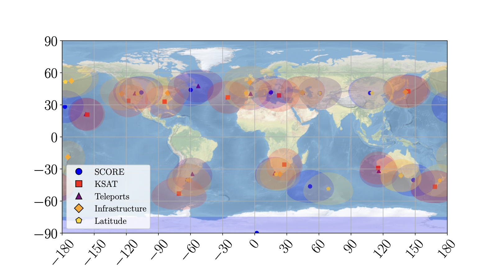

# loc-gsopt

Free-placement optimization of ground station locations for low-Earth-orbit satellites.

Code for: Kim, Eddy, Srinivas and Kochenderfer, *Free-Placement Optimization of Ground Station
Locations for Low-Earth-Orbit Satellites*, Journal of Aerospace Information Systems (2026)
([arXiv:2606.12667](https://arxiv.org/abs/2606.12667)).

This repository implements our paper's ground station placement optimization methods for
low-Earth-orbit satellite constellations, with a focus on maximizing total data downlink. Ground
station locations are optimized over continuous longitude and latitude coordinates using our method
**SCORE (Sequential Cyclic Optimization via Refinement & Evaluation)**. SCORE first places stations
sequentially, selecting each location to maximize the additional downlink given the existing
network. It then cyclically refines individual station locations while holding the others fixed,
accepting only changes that improve total downlink. The method supports different inner optimizers,
such as Nelder-Mead and Powell's method, both included here. Placement constraints are incorporated
through penalty terms for land placement, minimum station separation, and optional restrictions on
latitude and proximity to existing infrastructure.

In the paper we test SCORE on the Capella Space and ICEYE constellations and on a synthetic
Walker-Star constellation. Compared with differential evolution, it needs up to 5× fewer function
evaluations and downlinks up to 13% more data. Compared with choosing from fixed teleport or KSAT
sites, it downlinks up to 15% more in total, and it keeps over 92% of that gain when stations have
to be near existing infrastructure.



## Installation

The project uses [uv](https://docs.astral.sh/uv/):

```bash
git clone https://github.com/gkim65/loc-gsopt.git
cd loc-gsopt
uv sync
```

Two tools come from outside Python:

- **CBC**, the free MILP solver used to resolve overlapping contacts: `brew install cbc` on macOS,
  `sudo apt install coinor-cbc` on Debian/Ubuntu. If you have a Gurobi license, you can use it
  instead with `problem.solver=gurobi`.
- **LaTeX**, only for the figure scripts, which typeset labels with `text.usetex`.

## Quick start

[`examples/quickstart.ipynb`](examples/quickstart.ipynb) places one station with SCORE in a few
minutes. From the command line:

```bash
uv run python src/main.py problem.method=nelder_ccgs problem.gs_num=2
```

Each run writes `results.json` (selected stations, contact count, contact seconds, data downlinked
in bits, objective evaluations) and `gs_all.png` to its Hydra output directory,
`outputs/<date>/<time>/`.

## Methods

| `problem.method` | Method |
|---|---|
| `nelder_ccgs` | SCORE with a Nelder-Mead inner search |
| `powell` | SCORE with a Powell inner search |
| `diffEvolution` | Differential evolution over all stations at once |

Settings live in [`config/config.yaml`](config/config.yaml) and can be overridden on the command
line, e.g. `problem.gs_num=5 problem.sat_num=34 scenario.constellations=ICEYE`.
`scripts/run_sweeps.sh` runs the SCORE and Powell seed sweeps over ground station counts.

### Weights & Biases

Logging to W&B is off by default. To turn it on, run `wandb login` once, then add
`debug.wandb=True`. Runs log to `WANDB_ENTITY` or your default entity unless `wandb.entity` is set.

## Reproducing the paper figures

The figure scripts read the results in `data/csv_Files/` and write PDFs to `figures_final/`. Run
them from the repository root, e.g. `uv run python src/HeatmapPlots.py`.

| Script | Figures | Data |
|---|---|---|
| `src/linePlots.py scenario.constellations=CAPELLA` | `capellaDataDownlink.pdf`, `capellaDataDownlink_zoom_GS2.pdf` | `nelder_CAPELLA.csv`, `nelder_lat2_CAPELLA.csv`, `nelder_infra2_CAPELLA.csv`, `milp_CAPELLA.csv`, `ksat_CAPELLA.csv` |
| `src/linePlots.py scenario.constellations=ICEYE problem.sat_num=34` | `iceyeDataDownlink.pdf`, `iceyeDataDownlink_zoom_GS2.pdf` | the `ICEYE` versions of the above |
| `src/HeatmapPlots.py` | `heatmap_comparison.pdf`, `heatmap_comparison_vals.pdf` | `nelder_heatmap.csv`, `powell_heatmap.csv`, `DE_heatmap.csv` |
| `src/lineComputePlot.py` | `score_improvement.pdf` | `nelder1aggregated_runs.csv`, `dE1aggregated_runs.csv`; also rewrites `nelderAblate_wide.csv` from `nelderAblateall_runs_combined.csv` |
| `src/SCOREAblation_LinePlot.py` | `SCOREsweep_grid.pdf` | `nelderAblate_wide.csv`, `nelder1aggregated_runs.csv` |
| `src/DEAblation_LinePlot.py` | `individual_runs.pdf`, `DEsweep_grid.pdf` | `DEimprovement_plot_data.csv`, `nelder1aggregated_runs.csv` |
| `src/surrogateOptPlot.py` | `surrogate_convergence.pdf` | `surrogate_convergence.csv.gz` |
| `src/stationMap.py` | `capella_comparison.pdf` (set `constellation` in `main()` for `iceye_comparison.pdf`) | station coordinates in the script |
| `src/multiStationMap.py` | `multiStation0.pdf` to `multiStation4.pdf` | station coordinates in the script |

When a CSV is missing, the script rebuilds it from the paper's W&B projects, which needs access
to the `loc_gsopt` W&B team. [`examples/reproduce_figures.ipynb`](examples/reproduce_figures.ipynb)
runs the scripts in turn.

## Data

| Path | Contents |
|---|---|
| `data/celestrak_tles.txt` | TLE snapshot from [CelesTrak](https://celestrak.org), downloaded around 10 April 2025 (its newest TLE epoch) |
| `data/iau2000A_finals_ab.txt` | Earth orientation parameters, downloaded around mid-January 2025 (measured values end 16 January 2025; later dates are predictions) |
| `data/ne_10m_admin_0_countries.*` | Country boundaries from [Natural Earth](https://www.naturalearthdata.com/downloads/10m-cultural-vectors/), for the on-land penalty |
| `data/teleport_locations.json` | Teleport locations |
| `data/city_buffers.*` | 50 km buffers around the teleport locations, for the infrastructure penalty (made by `data/citymap.py`) |
| `data/most_diverse_100_ground_stations.json` | The 100 candidate sites for the MILP baseline |
| `data/groundstations/` | Ground station lists for commercial providers |
| `data/csv_Files/` | Results behind the paper figures |

The TLE and Earth orientation files are snapshots tied to the paper's simulation window
(1–8 April 2025). Keep them to reproduce the paper; a newer TLE download gives different satellites
and epochs. The `jais-2026` tag holds the code and data exactly as used for the paper.

### Configuration notes

`problem.objective` supports `data_downlink`. The gap-time and contact-count objectives and the MILP
teleport-selection path (`problem.type=teleport`) are kept in the code but raise
`NotImplementedError`; the MILP results used in the paper are in `data/csv_Files/milp_*.csv`.

## Citation

If you use this repository, or build on this work in general, please cite:

```bibtex
@article{kim2026free,
  title={Free-Placement Optimization of Ground Station Locations for Low-Earth-Orbit Satellites},
  author={Kim, Grace Ra and Eddy, Duncan and Srinivas, Vedant and Kochenderfer, Mykel J},
  journal={Journal of Aerospace Information Systems},
  volume={23},
  number={10},
  pages={975--994},
  year={2026},
  publisher={American Institute of Aeronautics and Astronautics}
}
```

## License

[MIT](LICENSE)
